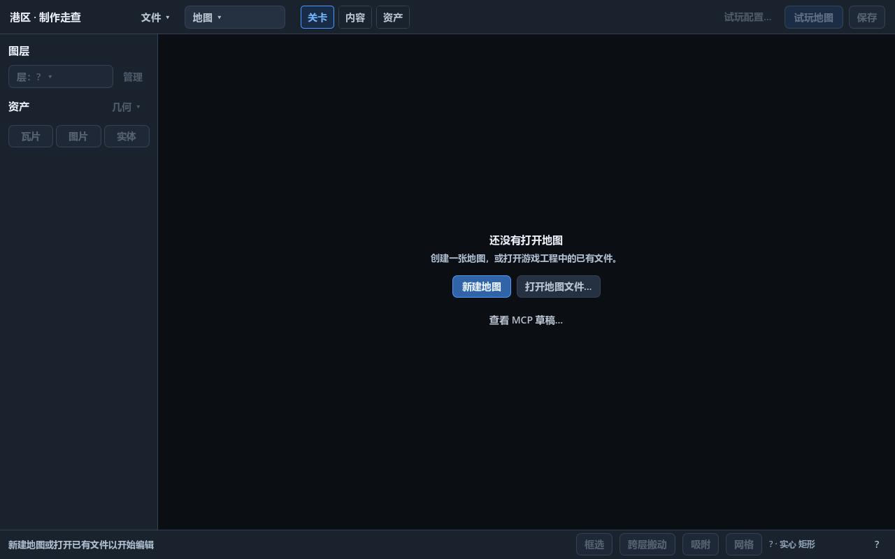
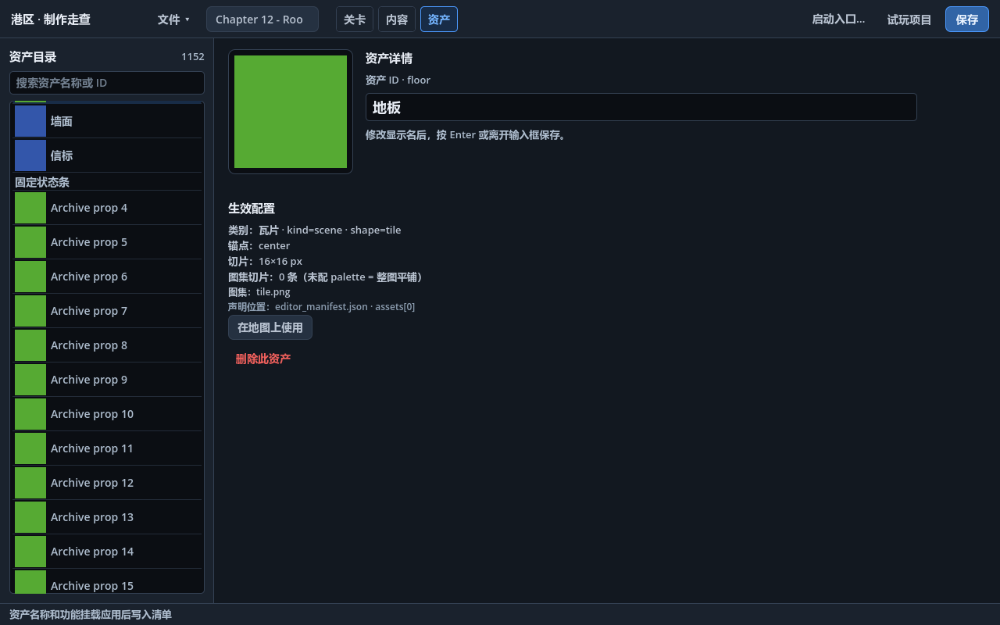
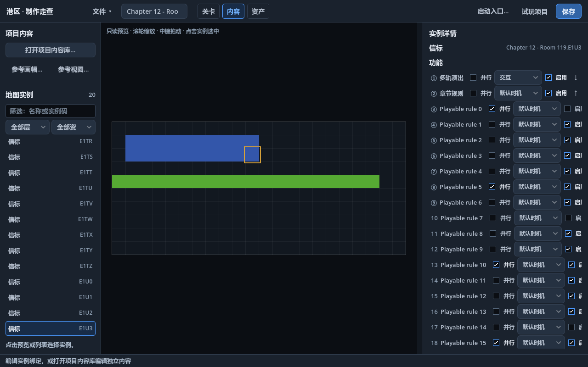
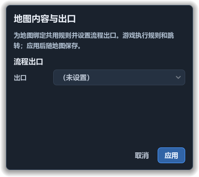
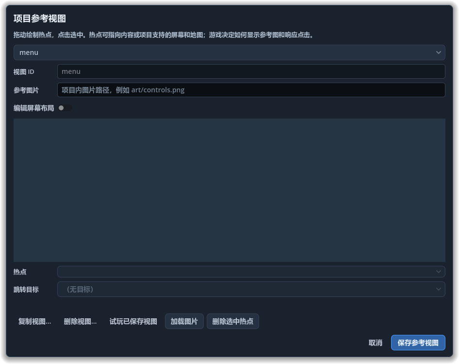
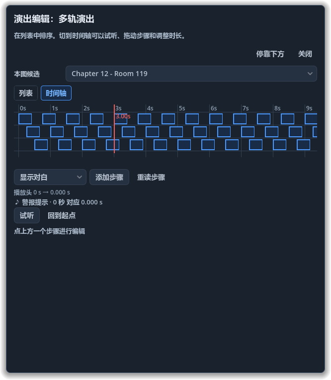
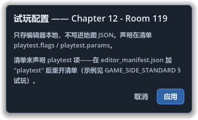

# 2D 游戏编辑器：从开工到交付的制作体验审查

审查日期：2026 年 11 月 28 日。被审查版本：`79d8014`。重点是人怎样在界面中完成制作，AI/MCP 单列。本文记录现状、改进设计和验收方法；方案尚未实现。

## 结论

**小项目能完成真实制作；到了中后期，编辑器仍能编辑这些数据，但还不能稳定地让人看懂当前进度、判断下一步、低成本接着做。** 最大的问题不是没有搜索，而是工具把「项目里有什么」直接呈给作者，没有充分回答「我正在做什么、现在有哪些合适的选项、加进去会发生什么」。在实际界面中，1,152 个资产依然主要靠平铺列表发现；有 36 条绑定的实例，右栏已经难以读清内容名，添加入口还在列表末尾。这两处也会让**新做一张图、继续编排一个对象**变慢，跟是否需要找旧内容无关。

建议先做两个能被现有面板共用的能力：**按当前任务给出有解释、可扩展到全库的候选；按当前对象显示可读、可定位插入位置的编排列表。** 把这两项带进开工、续作和批量生产，再把引用检查、正式入口、试玩加载结果接成短路径。原有画布、无限图层、资产与实体分工、实体—能力—内容、同级执行内容、图组整组排序都适合继续使用。

### 证据和范围

- **实图**：在隔离的应用配置中打开真实 Godot 编辑器，用 120 张地图、1,152 个资产、124 个功能的构造项目取图。重点检查一张地图的 20 个同类信标、一个实例的 36 条绑定、一份演出的 42 步三轨，以及接入、图鉴、图组、地图出口、屏幕布局、正式启动入口和试玩配置。这批数据用来把界面挤到中后期规模，贴图重复不记为产品缺陷。
- **代码**：顺着 `src/` 的菜单、状态、表单、流程和试玩实现核对，区分截图所见和需要设计/验证的行为。文中「拟议」描述期望行为。
- **已有实测**：[真实制作与试玩报告](EDITOR_LIVE_AUTHORING_AND_USABILITY_2026-11-28.md)已有不同视角的可玩原型和小规模鼠标操作；[对抗审查](EDITOR_SRC_ADVERSARIAL_AUDIT_2026-11-28.md)有已确认的引用和保存问题。本轮未对大型构造项目逐张试玩、未做多人可用性测试、未验证最终游戏发布包。规模结论来自界面和实现，耗时目标是后续验收指标。

## 1. 判断一项操作是否适合规模化

作者在每一屏只需要回答四件事：**我在哪儿、下一步能做什么、要动哪一项、如何知道做对了。** 画布应给出空间答案，列表给出结构，详情给出准确输入，试玩提供游戏运行证据。四者之间用同一项身份定位，往返不丢工作位置。

| 场景 | 人实际怎样判断 | 编辑器应先显示什么 |
| --- | --- | --- |
| 从几百张图里开工 | 我在做哪一段？从哪张照着做？ | 本次工作涉及的几张图、当前图的同组或有连接的图、全项目浏览入口。 |
| 从几百个资产里找可用的 | 我知道用途或外观，但不知道名字 | 瓦片/场景资产/实体等当前放置类型、项目资源集合、可比较的图标和尺寸，再加当前图或参考图已使用的素材。 |
| 加功能 | 我希望在一个具体时机让对象做一件事 | 插入位置、触发时机、资产提供的挂载，以及候选为什么出现。名称输入只是缩小范围的手段。 |
| 继续复杂编排 | 我想接在某一句、某次触发或某个节拍之后 | 可以读懂的内容名、真实序号/时间、相邻行、明确的插入位置和详情。 |
| 收尾 | 这个入口会加载什么，哪部分已经试玩？ | 正式入口和数据状态、可验证问题和可跳转来源、最近运行的入口和加载结果。 |

这里有三种边界：**身份**用现有 ID，**运行关系**用已声明的绑定、出口、时间和图组范围，**编辑视图**可以有标签、收藏、过滤、分段和工作集。编辑视图不改变执行顺序、作用域或 ID；项目可以按章节、地点、任务或者任何自定义方式浏览，同一个对象可出现在多个视图里。编辑器只理解通用的选择依据，具体模块意义由游戏侧提供，不为游戏类型增设专用面板。

## 2. 开项目、接入和制作第一个闭环

**实图**：启动引导明确要求选择含清单的游戏根目录。首次用此配置打开已有 120 张地图的项目，工作区主文案仍是「还没有打开地图」，强调新建或打开文件，没告诉作者项目内已有 120 张地图，也没有把浏览这些地图当成主动作。这里观察的是首次进入已有项目；未验证此前操作后的会话恢复行为。代码锚点：[项目打开](../../src/app.gd#L172)、[主工作区空态](../../src/ui/editor_layout.gd#L115)。

**拟议**：沿用空态区域，根据项目的有效数据切换主动作。

| 已知事实 | 开工主动作 | 同处显示的有效信息 |
| --- | --- | --- |
| 清单未接入或不能读 | 选择游戏目录 / 重开清单 | 出问题的文件、字段和修复方；可选能力未声明不显示成错误。 |
| 已接入且没有可续的会话 | 按已有内容提供「浏览项目地图」「打开内容/屏幕」或「新建」 | 地图、可编辑内容、可放置资产的数量；没有地图时仍可从内容或屏幕开工。 |
| 已有会话 | 「继续上次」；草稿另标来源 | 上次目标和编辑模式，地图或内容已经移动时退回相应目录。 |

开始制作时给出**空白新建、复制现有、使用游戏侧已声明的生成入口**，沿用现有实现。复制前用一句话显示会带上什么、共享哪些引用。新建先给名称、尺寸和适用的项目默认值；投影、拓扑、基向量等能决定设计上限的设置仍可展开。作者可以从一张图、一段演出或一个菜单切入。首次做出可玩的交接点，是让作者能在刚编辑的对象旁看到**从这里试玩**及其可用条件；例如「从地图出生点启动」「用此屏幕草稿启动」，没有声明的方式不冒充可用。新手提示附在触发实际动作的位置，例如首放成功后标出撤销和继续放置，完成后收起。

## 3. 中期每天怎么推进：找图、选材、放置

### 3.1 以少量工作中的地图进入项目

**实图 / 代码**：画布可直接绘制，左边已有图层和资产；长图名在顶栏被截断。地图切换从顶栏生成图菜单，已有整图复制、跨层区域复制等工具；这些能降低重复制作成本，但菜单本身没有表达「新图可以借鉴哪张图、属于哪段制作工作」。见[地图导航](../../src/ui/top_bar_nav.gd#L54)和[地图工具](../../src/ui/editor_layout.gd#L182)。构造样本打开后自动补齐了类型挂载，故状态有待保存变更，不能据此认定打开会无故污染正常地图。

**拟议**：顶栏仍做快速切换；增加同一入口展开的「项目地图」浏览视图，先列**本次打开/最近打开、与当前图显式相连、图组共同覆盖的图**，再按项目作者自己定义的集合或自然名称浏览全项目。每行用完整名称、地图码、必要时小图，给出打开、复制为新图、回到上一张的快捷操作。允许把接下来要连续制作的几张图固定下来，对本机的视图偏好不需要写进运行数据。

例如做第 121 张图，作者先从「港区」看相邻地图，选一张作为参照，决定整图复制还是只跨图复用一块布置。打开新图后可以快速回到参照图，再切回来继续摆。地图浏览集合是作者的导航选择；它与世界的空间关系、与图组对哪些地图生效是三件事。

### 3.2 让作者不输名字也能选到合适的资产

**实图 / 代码**：图鉴已有名称/ID 搜索、缩略图和「在地图上使用」；画布已有分类，瓦片有最近用过入口，部分资产可直接用。实测的图鉴仍是平铺目录，选中后才能在右侧看详情。放到一千量级，知道名字可以找，但「看起来像港区木桥断口，方向和尺度要对」很难核对。[资产图鉴](../../src/ui/asset_panel.gd#L183)、[放置面板](../../src/ui/palette_panel.gd#L206)。

**拟议**：在现有图鉴和放置面板共享同一组量少但有效的浏览依据，选完仍回到地图。

1. **先把用途缩对。** 切换瓦片、场景资产、实体时显示对应候选；有可验证兼容规则才做硬过滤，并让作者看到原因。没有贴图的实体照常在可放置的任意图层选取，使用统一的锚点/类型图标。
2. **展示「为什么在这里」，让选材可以从参照开始。** 默认显示当前图已用、参照图已用、临近地图已用、最近/固定中的相关集合。可继承现有瓦片分类；项目若愿意，可提供一组可选分类或标签（例如 `港区`、`木构`、`可交互`），不规定子类，也不要求几百项一次性打完标签。没有标签仍有可用的浏览路径和全库入口。
3. **在同处比较，再落地。** 网格缩略图让相似选项同时可见；选中时展示有效占格、锚点、可用方向等已知信息。选取后返回原缩放、图层和位置，画布预览实体锚点/覆盖区域，落地前能取消或换资产。画布上可取样当前对象，迅速继续同类布置。找「相似」是复用集合和类别，编辑器不需要自行识别游戏美术含义。

在画布上继续保留场景资产和碰撞的不同编辑目标。层很多时，常驻的是当前图层名及可见/锁定状态，作者可快速单独看一层、恢复刚才的可见性、定位选中物所在层。用于查看的隐藏或隔离状态应和随游戏数据交付的图层可见性清楚区分。地图内做视觉改动时默认仍在当前地图；看叠加效果才显式打开图组上下文。

## 4. 中后期最应该先改：继续编辑一个复杂实例

### 4.1 找到一个已摆放的实例并知道自己在改什么

**实图 / 代码**：可以按名称/实例码、图层和资产查本图对象，图与列表互相选择。样本中 20 个同型实例都显示「信标」，视觉上主要靠实例码区分；36 条绑定挤在右栏，第一屏多为控制行，内容名和右侧若干操作被裁切。未验证键盘是否仍能聚焦到裁切的每个操作。[实例列表与右栏](../../src/ui/content_editor.gd#L482)、[绑定行构造](../../src/ui/fn_bind.gd#L58)。

**拟议**：对象清单行采用「实例备注名（可选） / 类型 / 图层 / 可定位的坐标」；ID 在复制标识、技术排查和同名第二行可见，仍是引用依据。鼠标从画布选中对象时定位清单项，清单点选时在画布标出位置。通用面包屑显示「地图/图组 → 实例 → 绑定 → 内容」，其中图组来源要明确，防止作者以为在当前地图改了一次性事件。

### 4.2 编排列表让人先读懂，再就地插入

**代码**：绑定表单在列表之后，`+ 添加功能` 也是底部行；添加菜单枚举清单中的可选功能，操作以逐行上移/下移为主。[构建列表](../../src/ui/fn_bind.gd#L58)、[添加菜单](../../src/ui/fn_bind.gd#L196)、[移动](../../src/ui/fn_bind.gd#L368)。资产挂载得到的行应标出来源；保留现有规则：它可调整顺序，但不能像手动添加的绑定一样直接从实例移除。

**拟议**：在当前内容页做一个可拉宽的「编排」视图，作者能保留画布上下文；窄屏可打开宽视图，保存和返回仍落在原实例。每行默认只显示**真实序号、触发时机、功能名、内容名、状态**，把稀少操作收进详情或行菜单，标题不被一排按钮吃掉。选中行的表单固定在右侧、下方或独立详情区，不随前面列表增长被埋到底。按触发时机/启用状态筛选能读局部，未筛状态总有完整真实顺序。

具体路径：作者选中「#18 入场 → 播放台词」，点「在后面插入」，选择「入场 → 镜头移动 → 引用共享演出/新建」，提交后显示「新增 #19」，保留原滚动位置并可直接继续。界面同时给常驻「添加功能」用于追加。筛选后可显示 `#18、#23`，两行在完整列表并不相邻；添加和移动应明确锚在哪一条实际记录，跨越隐藏项时展示实际落点或切回完整顺序操作。拖放、菜单和键盘共用同一真实顺序；不把过滤器变成执行排序器。并行和触发规则按声明及现有数据呈现，列表不从功能名猜执行先后。

**如何从 124 个功能里选**：顶部先确认「给哪个实例、哪个位置、已选触发」；候选默认按「当前实体类型的已有挂载或明确关联」「本图/参考图用过」「最近使用」「其他可选」排列。项目可为模块附简短用途、可选分类或提示，用在显示和候选组织；已声明的触发能力才用于确定不可用。诸如镜头、声音、战斗等标签允许由项目自由定义，不是编辑器类别协议。不确定触发时可先选功能再选时机；任何建议都可展开到全体可选项。添加后明确是使用共享内容、复制后本地改、还是创建新内容，让下一步可完成。

## 5. 跨地图、图组、流程、屏幕和长演出

### 5.1 地图与图组：让作者知道改动在哪些地图生效

**实图 / 代码**：顶栏「图组」打开偏绘制管理入口；项目内容库还有完整入口。地图的内容槽和出口有专门编辑窗口，通过「应用」随图保存。流程工具已能聚焦邻域，大于 250 节点时默认邻域视图，不应再造一张全项目巨图。[图组导航](../../src/ui/top_bar_nav.gd#L160)、[图组选择范围](../../src/ui/event_layers_dialog.gd#L112)、[地图关系](../../src/ui/map_flow_dialog.gd#L25)、[项目流程](../../src/ui/project_content_library.gd#L338)。本轮图组截图是无配置的空态，多组实际叠加以代码为依据，仍应纳入后续规模验收。

**拟议**：从当前地图的上下文能看到「哪些图组覆盖本图、各组整组绘制顺序、这一组还覆盖多少图、此对象写回地图还是图组」。作者预览叠加时选一张地图作为背景，能单独看组、查看其余受影响地图，再返回图组编辑。图组不拆层与地图层混排；图组名称/范围应在保存前就可看见。空间碰撞、屏幕固定或游戏解释的数据，界面只展示声明和实际可编辑的配置；运行效果用试玩验，不从有无碰撞层、贴图或图组名字推断。固定 HUD 若按项目契约在图组实现，直接从图组到对应资产/内容，不强制另做一套屏幕布局。

对流程采用「选当前对象看一跳」：能看到出口去向、哪些显式入口来到这里、使用了哪些图组或共享内容，点一条能打开确切字段并支持返回。流程图适合找路径和理解邻域，关系表适合准确维护几十条关系，复用同一份引用枚举。游戏动态决定的跳转只在有明确声明或运行观测时呈现，不把「结构图里没有边」当作地图不可达。普通未配置出口也不能单凭这一点判错。

世界布局用于空间摆放，视图强调坐标和普通地图；选地图时明确种类，用游戏侧支持的目标类型决定候选。此前实测发现图组绘制文档看起来像普通世界地图候选，优先做分类和落点提示。一个对象可能同时出现在作者收藏、世界空间、图组适用图或流程图中，打开后的面包屑明确当前是哪种关系，交叉跳转回来的时候恢复原选择。

### 5.2 屏幕和对话：先呈现作者要编辑的内容

**实图**：项目已有 `menu` 布局，从「项目参考视图」进入却默认在热点模式，首屏看起来像空白。这是入口与模式不清，截图不证明布局缺失。已有画幅、语言、焦点和游戏渲染等能力可继续沿用。[参考与屏幕入口](../../src/ui/reference_view_library.gd#L21)。

**拟议**：同一工作面板提供能直接进入的「屏幕布局」和「参考热点」两个入口或清晰模式切换。显示当前屏幕、设计画幅、预览语言和数据来源；切换模式保留工作对象。空间 HUD 与屏幕固定 HUD 要在自己的坐标和预览上下文中操作。对于对话、规则等可读内容，列表优先给句子摘要、资源名、条件或目的地等清单能表达的字段；点内容再编辑完整文本与引用。需要确认运行行为时直接从对应入口试玩；没必要强制每类数据都有独立预览器。

对游戏设置这类内容，同一屏可从按钮跳到它绑定的内容和参数，按返回回到同一控件。例如在音量设置画面选中「音乐音量」滑块，看到与它关联的游戏侧能力、值来源和适用范围；预览检查排版和焦点，试玩检查拖动或键盘操作是否真的改变音量。正式游戏设置与试玩临时参数必须用不同标题，不因名字都是「音量」就混成一个值。画幅、语言、焦点是收尾时可按当前屏幕逐个查看的上下文，不要求拆出专门项目级界面。

### 5.3 长演出：让概览、精确调整和观察同屏配合

**实图 / 代码**：42 步三轨在全段尺度下的窄色块几乎无名称。已有缩放和游标、步骤列表分页、按编号定位、复制段落和预览；它们解决「怎么操作某一步」，尚不足以让刚回来的人看懂「这部分演什么、在哪一步往下接」。见[时间游标和时间线](../../src/ui/steps_panel.gd#L980)、[步骤表单](../../src/ui/steps_panel.gd#L1096)。按指定时间打开时读数与游标不一致是[已报告的独立问题](EDITOR_LIVE_AUTHORING_AND_USABILITY_2026-11-28.md)，应和视图优化分开验。

**拟议**：每轨有可读名称/图例，可给时间段加编辑标记，例如「推进镜头」「警报响起」「交还控制」。轨名、折叠、段标记是编辑视图的辅助；原时间、字段、同级结构照旧。时间线旁提供与光标同步的摘要列表：时间、步骤名、目标或文本摘要；从列表选中一步时滚到对应轨和表单，添加可沿用当前光标或选中行之后，并明确是追加到同一时刻还是修改时间。支持选定一段做复制预览和整体偏移，核对起止时间、重叠和受影响的步。已有音频/图像/动画预览保留；只有游戏运行才解释的操作，显示「编辑器看得到时间和参数，效果请从此处或这一入口试玩」。

## 6. 批量维护期间仍要继续做内容

**现状**：内容库已经能打开和复制独立内容，绑定能从库中选取内容；资产有删除引用检查，流程已有局部浏览。几个入口分在不同界面，作者很难连续完成「看影响→选一小批→修改→复核→回刚才的图」。引用完整性已有明确的对抗审查发现，先消除其中的漏项，再把引用视图作为批量决策依据。[资产删除使用情况](../../src/ui/asset_panel.gd#L390)、[项目内容库](../../src/ui/project_content_library.gd#L39)。

**拟议**：优先补全作者最常作的两种小批量操作：**对已选实例复用一组绑定、对显式引用把选中的使用处重绑到某一内容**。浏览器/列表先选定图、图组、类型或某个具体字段和值，可继续缩小选择；预览显示实际被选的对象、原值、改后和共享范围。提交后沿用已有撤销或草稿/历史写入口，按实际支持的范围显示撤销能力，应用后返回原工作位置。别用名称包含「信标」就跨图替换，也别把「相似对象」当作已经选中。

示例：一份通用开门演出被许多地图使用。作者希望只更换港区的三处。先在原共享内容查看来向，选择三条实际绑定，复制一份演出并只重绑这三条；新版本应列出三处变化，旧版本及其余引用原样保留。如果真正要整体改标准演出，则应明确进入共享内容，预先显示来向数量和范围。游戏侧下次更新清单后，若能力/字段下线，问题列表应显示具体缺项和受影响对象并说明由哪一侧修复，合法但暂不使用的能力不应当成问题。

## 7. 观察、试玩和交付：知道自己测的是什么

**实图 / 代码**：有正式启动入口，能入已发布内容、屏幕或地图；有地图、项目入口及按游戏清单开放的其他试玩方式。代码跟踪进程，对声明支持的游戏读取加载回执。大型样本接了试玩可执行文件但未声明可调参数；「试玩配置」却显示「清单未声明 playtest 项」，实际只检查了 `flags/params` 是否为空。[启动入口](../../src/ui/startup_dialog.gd#L21)、[回执与配置](../../src/ui/playtest_controller.gd#L130)。这是容易误导接入判断的文案和状态错误，可独立小修。

**拟议**：保持现有按钮和面板，把「启动入口」「试玩配置」「试玩结果」连起来。启动前就显示如下信息；入口不同，标签和能做的操作随之变化。

| 观察方式 | 应让作者明确知道 |
| --- | --- |
| 编辑器静态预览 | 使用了哪个地图/图组/屏幕、正在看哪种预览和画幅；不会替作者验证游戏负责的逻辑。 |
| 游戏渲染预览 | 游戏实际渲染的对象、当前配置或草稿，并能返回对应对象。画面不等同于触发流程已跑通。 |
| 从当前目标试跑 | 要启动的是地图还是某个内容/屏幕入口，哪份数据将被用到、是否会先保存、有哪些试玩专用参数；不支持该入口时给出可用路径。 |
| 从正式入口试跑 | 正式入口及其指向的已保存目标、实际加载的数据标记和最近一次回执。用户看完能回到原地图、选中实例或演出的原时间位置。 |

例：从菜单开始试玩，结果显示「正式入口 `menu` · 启动成功 · 游戏回复已加载本次数据」；加载错误则显示真实返回消息。未开启回执时只能说进程已启动或已退出。加载成功只证明该次数据被读到，不能替代作者确认按钮、分支、碰撞、图组叠加等游戏行为。提供一个轻量的最近结果/重新试玩和按入口定位；无需为了收尾建立任务看板或覆盖率平台。

交付前，作者应能用同一条路径完成：**保存当前制作数据 → 检查声明和显式引用 → 处理能定位的问题 → 走关键入口和分支 → 确认游戏侧拿到的实际文件 → 用游戏侧导出的发布包独立启动。** 编辑器负责能判定的结构，例如缺失 ID、错误触发、入口对象不可用、声明的图组目标失效；未观察到的动态规则不能标成失败。结构检查结果按「需要修」「建议查看」「游戏侧运行确认」分开，能跳回地图、实例、绑定、内容、字段或时间。作者应能区分当前未保存编辑、编辑器已保存数据、MCP 草稿、游戏发布包分别是哪一份。**编辑器 EXE 是作者工具的交付物；游戏发布包由游戏侧产出并验证。**

## 8. 贯穿全流程的界面规则

用同一套信息层次整理现有面板，每一次切换只带进当前任务需要的信息。

| 界面部分 | 默认提供 | 深入时再提供 |
| --- | --- | --- |
| 顶栏 / 面包屑 | 当前项目、当前地图/图组/内容、角色明确的保存与试玩；窄屏中长名字仍可完整查看 | 跳相邻对象、复制 ID、显示文件或来源。 |
| 本地浏览区 | 先给类别、当前范围、候选数量；选择后直接使用 | 项目标签、最近/固定、全库、名称或 ID 匹配。保留这次放置的筛选，而非强制重输。 |
| 列表和详情区 | 列表可读且可选，选中再编辑；新增/插入常驻，图标有标签或提示 | 复制、引用、排序等收入可触达的行菜单。面板拉宽、键盘焦点和滚动行为统一。 |
| 操作反馈 | 反馈贴着发生处：「#19 已加到信标」「正式入口已保存」 | 需要持续处理的问题留在检查/试玩视图；能定位，长信息不会被下一条状态覆盖。 |

键盘与鼠标应能完成同一条主路径：候选打开后有可见焦点；方向键能选择，Enter 确认，Esc 逐级返回；退出选项弹窗回到触发它的行或按钮。要求是关键文本、选择和提交操作在常用窗口尺寸及放大时仍可触达；不能用鼠标悬停提示代替必读标题，也不能用颜色单独表达禁用、未保存或裁切。地图、对象清单、流程、图组和时间线导航回来应恢复对象位置/滚动/过滤和光标；使用现有稳定 ID。时间步骤如缺少跨编辑稳定身份，先用本次编辑能解析的语义定位，不能把数组下标许诺为跨版本 ID。

## 9. AI/MCP：让同一套制作上下文也能被查询

前轮独立黑盒样本是 120 图、1,024 资产、124 功能、2,400 实例和 2,400 份内容，每份 8 步。地图按名字查和分页有效；一个共享内容能查到 120 张图的来向；持已知 ID 可一次在草稿改 12 份。对应成本是：资产需要先拿完整声明自行解析；内容正本响应主要给 ID，按测试显示名找不到，同一数据进入草稿后能命中；全项目实例需要逐图查询；`diff` 返回改后的完整内容，不能直接告诉作者哪几个字段变了。[现有查询](../../src/mcp/workbench.gd#L212)、[草稿差异](../../src/mcp/drafts.gd#L42)。

这些适合与人用界面共用一套读取逻辑：给定地图/实例/触发，返回少量有原因的候选和可分页的全部候选；正本和草稿用同样的名字、作用域与摘要字段；增加按地图集、资产或功能查询实例和绑定的有范围分页；保留按 ID 精确读取、现有草稿/校验/截图/发布。草稿先给「变更对象、路径、旧值、新值」的差异摘要，需要时再读完整文档；纯内容草稿也应能到人工审阅入口。截图最有用的时机是确认画布、布局、演出或试玩效果，结构查询能回答的事情不用让 AI 从截图反推 ID 或把几百份文件逐个传进上下文。[当前草稿审阅](../../src/ui/mcp_draft_review.gd#L68)。

## 10. 实现顺序与判定标准

这是依赖顺序，同一个设计应贯通现有入口。建议延用现在的清单读取、地图/内容/图组写入、流程邻域、试玩启动和撤销/草稿机制。

1. **先修看不清和做不下去的地方。** 让绑定标题、状态、添加、定位插入、详情达到可读可达；修两种容易误导的入口/状态：屏幕布局默认落到热点，以及把没有可调试玩参数说成没有试玩接入。主入口空态知道现有项目内的数据，顶栏能显示完整当前目标。
2. **共用候选、摘要和定位。** 资产放置、功能添加、引用选取、流程和 AI 用相同的摘要与范围。先做当前对象、已用、同组/相连、最近和全库；已有数据足以跑通。项目可选标签与收藏只在合适的地方提供，不把分类劳动塞给每个开发者。
3. **把密集编辑和收尾接起来。** 时间线摘要和段标记、图组实际生效范围、引用影响和小批量重绑复用这些能力；先补前轮确认的引用漏项和人工编辑保护，再把问题、正式入口、试玩回执连成可返回的工作路径。

技术落点先做小的读取层：使用现有声明和文档索引，统一返回「显示名、类型、ID、所属范围、摘要及可跳转位置」，过滤与推荐保留清楚的来源。`top_bar_nav`、`palette_panel`、`asset_panel`、`fn_bind`、`steps_panel` 和项目内容库各自保存原写入规则，共用候选展示和定位；MCP 读取同一数据。视图折叠、筛选和局部工作集可以是本机偏好；只有项目成员真需要共享的标签/说明才进入作者数据。先用现有数据表达能解释的关系，避免为新界面复制出一套与正本不同步的项目数据库。

用任务验收而不是点全菜单。对同一个样本比当前版和改后版，记录**能否独立成功、第一次正确选择前切屏/返回次数、误放/误绑次数、是否需要预知 ID、回到原目标是否要重找**。首次路径用未接触过项目的人，中期任务用知道目标但不知道资源命名的人；时间只作对照。以下是建议验收门槛，不是本轮成绩。

| 阶段 | 让作者实际做的事 | 通过的表现 |
| --- | --- | --- |
| 首次接入 | 打开空工程、已有 120 图的工程、无地图但有屏幕/内容的工程 | 每次可从首屏判断下一步；不需要把已有项目当空工程，也不必先建无用地图。 |
| 从零到可玩 | 新建或复制一图、画一层、摆无贴图实体、加一条能触发的对白、试玩 | 画布能直达该实例；无贴图实体不被错误限制绘制层；返回还在原对象；实际游戏看到预期内容。 |
| 继续生产 | 新做第 121 张图，在 1,152 个资产里选不知名的参照素材，比较两项，将其落到指定层 | 可不输入名字完成；能辨别来源和占位，落地后仍在原图层，方便连续摆放。 |
| 继续编排 | 从 124 个功能中选择给有 36 条绑定的实例，在 #18 后插入；再给 42 步演出选一段复制或偏移 | 不滚到尾部找入口；看得见候选理由、真实序号和落点；校验过滤后的插入顺序和时间，无关条目保持原样。 |
| 跨地图和 UI | 按现有规则叠三个重叠图组，关联若干地图；在屏幕设置内改一控件并试焦点/参数 | 能预见修改范围和图组顺序；地图和图组写入目标说得清；能直达真正模式；游戏按自己规则处理 HUD、碰撞和行为。 |
| 批量改动与清单变更 | 共享内容用在 120 张图，只把三处重绑到新内容；再测试一个实际失效的声明 | 预览和提交都恰为三处，能核对未选使用处；失效声明能定位到受影响对象，交代由哪侧处理。 |
| 收尾 | 从正式入口跑可验证流程，再用独立游戏发布包复查；让一个已知引用失效 | 能区分校验、加载回执和运行结果；问题能回到对应字段；没有回执时不会把进程启动说成已加载。 |
| 键盘和窗口 | 在窄窗口及更大文字下，用键盘完成选材、添加、改字段、返回 | 主要动作与焦点一直可见，文字读得全，返回原工作位置，鼠标也可走同一条路径。 |

附：其他真实界面证据——[接入引导](evidence/production-ux-20261128/01-welcome.png)、[地图画布](evidence/production-ux-20261128/03-map-workspace.png)、[图组空态](evidence/production-ux-20261128/08-groups.png)、[正式启动入口](evidence/production-ux-20261128/11-startup.png)。
